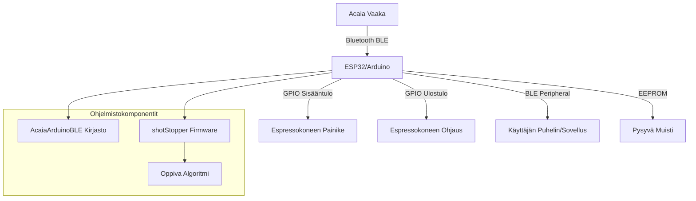
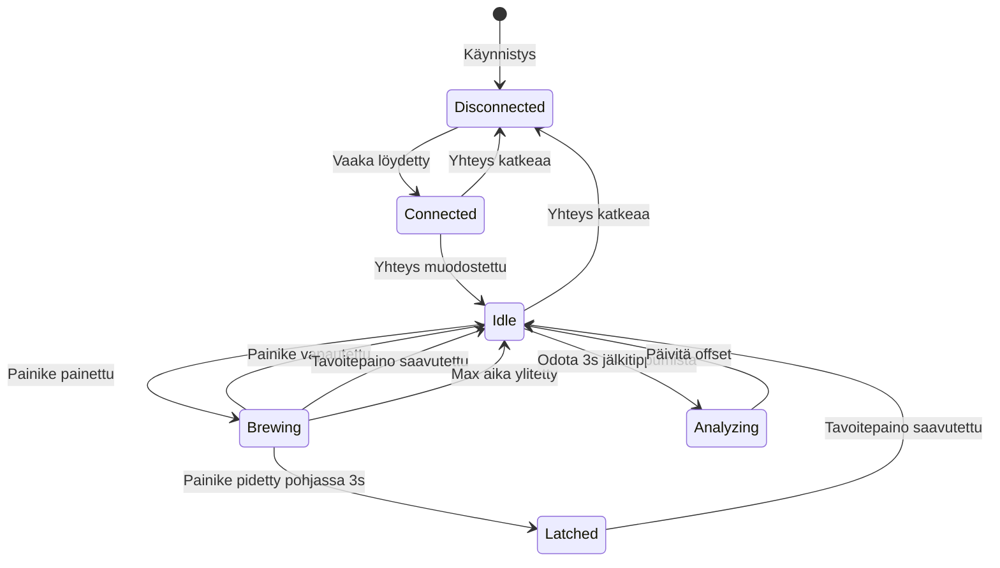

# Espresso Scale - Koodianalyysi

## Yleiskatsaus

Tämä projekti on Arduino-kirjasto ja laitteisto, joka yhdistää Acaia-vaa'an espressokoneeseen Bluetooth-yhteyden kautta. Järjestelmä pysäyttää espressokoneen automaattisesti, kun haluttu paino saavutetaan, ja oppii ajan myötä kuinka paljon etukäteen pysäytys tulee tehdä, jotta lopullinen paino on oikea (koska espressokone tiputtaa vielä kahvia pysäytyksen jälkeen).

## Järjestelmän Arkkitehtuuri



## Keskeiset Komponentit

### 1. AcaiaArduinoBLE Kirjasto

**Tiedostot:**

- [`AcaiaArduinoBLE.h`](AcaiaArduinoBLE.h)
- [`AcaiaArduinoBLE.cpp`](AcaiaArduinoBLE.cpp)

**Vastuualueet:**

- Bluetooth-yhteyden muodostaminen Acaia-vaakaan
- Painotietojen vastaanotto
- Vaa'an ohjauskomennot (tare, timer start/stop/reset)
- Tuki kolmelle vaakatyypille: OLD (pre-2021 Lunar), NEW (2021+ Lunar/Pyxis), GENERIC (Felicita Arc, Bookoo)

**Tuetut Vaa'at:**

- Acaia Lunar (USB-Micro ja USB-C versiot)
- Acaia Pearl S
- Acaia Pyxis
- Bookoo Themis Mini/Ultra

**Keskeiset Metodit:**

```cpp
bool init(String mac = "")           // Yhdistä vaakaan
bool tare()                          // Nollaa vaaka
bool startTimer()                    // Käynnistä ajastin
bool stopTimer()                     // Pysäytä ajastin
bool resetTimer()                    // Nollaa ajastin
bool heartbeat()                     // Pidä yhteys elossa
float getWeight()                    // Hae nykyinen paino
bool newWeightAvailable()            // Tarkista uusi painotieto
bool isConnected()                   // Tarkista yhteys
```

### 2. shotStopper Firmware

**Tiedosto:** [`examples/shotStopper/shotStopper.ino`](examples/shotStopper/shotStopper.ino)

**Vastuualueet:**

- Espressokoneen ohjaus
- Painon seuranta ja shotin pysäytys
- Oppiva algoritmi offset-arvon säätämiseen
- BLE-palvelin tavoitepainon asettamiseen

**Käyttäjän Konfiguroitavat Parametrit:**

```cpp
#define MOMENTARY false        // true = momentaariset kytkimet (GS3, Silvia Pro)
                               // false = lukittuvat kytkimet (Linea Mini/Micra)

#define REEDSWITCH false       // true = käytä reed-kytkintä brew-tilan tunnistukseen

#define AUTOTARE true          // Automaattinen nollaus shotin alussa

#define TIMER_ONLY false       // Vain ajastin, ei painon mukaan pysäytystä
```

**Tuetut Espressokoneet:**

- La Marzocco GS3 (reed-kytkin)
- La Marzocco Linea Mini/Mini R/Micra
- Rancilio Silvia Pro (X)
- Stone Espresso (reed-kytkin)
- Profitec Move
- Ascaso Steel Duo PID (testaamaton)

## Bluetooth-Protokolla

### Yhteyden Muodostaminen

1. **Skannaus:** Etsitään laitteita, joiden nimi alkaa: CINCO, ACAIA, PYXIS, LUNAR, PEARL, PROCH, BOOKO
2. **Yhdistäminen:** Muodostetaan BLE-yhteys
3. **Attribuuttien Löytäminen:** Etsitään oikeat karakteristikat vaakatyypistä riippuen

**Karakteristikat Vaakatyypeittäin:**

| Tyyppi  | Write Characteristic                   | Read Characteristic                    |
| ------- | -------------------------------------- | -------------------------------------- |
| OLD     | `2a80`                                 | `2a80`                                 |
| NEW     | `49535343-8841-43f4-a8d4-ecbe34729bb3` | `49535343-1e4d-4bd9-ba61-23c647249616` |
| GENERIC | `ff12`                                 | `ff11`                                 |

### Protokollakomennot

**Acaia-Komennot:**

```cpp
IDENTIFY[20]             = { 0xef, 0xdd, 0x0b, 0x30, ... }
HEARTBEAT[7]             = { 0xef, 0xdd, 0x00, 0x02, 0x00, 0x02, 0x00 }
NOTIFICATION_REQUEST[14] = { 0xef, 0xdd, 0x0c, 0x09, ... }
TARE_ACAIA[6]           = { 0xef, 0xdd, 0x04, 0x00, 0x00, 0x00 }
START_TIMER[7]          = { 0xef, 0xdd, 0x0d, 0x00, 0x00, 0x00, 0x00 }
STOP_TIMER[7]           = { 0xef, 0xdd, 0x0d, 0x00, 0x02, 0x00, 0x02 }
RESET_TIMER[7]          = { 0xef, 0xdd, 0x0d, 0x00, 0x01, 0x00, 0x01 }
```

**Generic-Komennot (Felicita, Bookoo):**

```cpp
TARE_GENERIC[6]         = { 0x03, 0x0a, 0x01, 0x00, 0x00, 0x08 }
START_TIMER_GENERIC[6]  = { 0x03, 0x0a, 0x04, 0x00, 0x00, 0x0a }
STOP_TIMER_GENERIC[6]   = { 0x03, 0x0a, 0x05, 0x00, 0x00, 0x0d }
RESET_TIMER_GENERIC[6]  = { 0x03, 0x0a, 0x06, 0x00, 0x00, 0x0c }
```

### Painotietojen Parsinta

**NEW-tyyppi (13 tai 17 tavua):**

```cpp
weight = (((input[6] & 0xff) << 8) + (input[5] & 0xff))
         / pow(10, input[9])
         * ((input[10] & 0x02) ? -1 : 1)
```

**OLD-tyyppi (10 tai 14 tavua):**

```cpp
weight = (((input[3] & 0xff) << 8) + (input[2] & 0xff))
         / pow(10, input[6])
         * ((input[7] & 0x02) ? -1 : 1)
```

**GENERIC-tyyppi (20 tavua):**

```cpp
weight = ((input[7] << 16) | (input[8] << 8) | input[9])
if (input[6] == 45) weight = -weight
weight = weight / 100
```

## Oppiva Algoritmi - Adaptive Pre-Stopping

### Konsepti

Espressokone jatkaa kahvin tippumista vielä hetken sen jälkeen, kun pumppu on pysäytetty. Järjestelmä oppii tämän "jälkitippumisen" määrän ja pysäyttää shotin etukäteen.

### Toteutus

**1. Offset-Muuttuja:**

```cpp
float weightOffset = 0;  // Tallennetaan EEPROM:iin (0-25.5g, 0.1g tarkkuudella)
```

**2. Pysäytyslogiikka:**

Shotti pysäytetään, kun:

```cpp
currentWeight >= (goalWeight - weightOffset)
```

**3. Oppiminen Shotin Jälkeen:**

Shotin päätyttyä odotetaan `DRIP_DELAY_S` (3 sekuntia) ja mitataan lopullinen paino:

```cpp
// Tiedosto: shotStopper.ino, rivit 340-368
if(currentWeight >= (goalWeight - weightOffset)
&& seconds_f() > shot.start_timestamp_s + shot.end_s + DRIP_DELAY_S){

    error = currentWeight - goalWeight;

    // Tarkista, ettei virhe ole liian suuri (MAX_OFFSET = 5g)
    if(abs(error) > MAX_OFFSET){
        // Virhe liian suuri, älä päivitä offsetia
        Serial.println("Error assumed. Offset unchanged.");
    }
    else{
        // Päivitä offset
        weightOffset += error;

        // Tallenna EEPROM:iin
        EEPROM.write(OFFSET_ADDR, weightOffset*10);
        EEPROM.commit();
    }
}
```

**Esimerkki:**

- Tavoitepaino: 36g
- Nykyinen offset: 1.5g
- Pysäytys tapahtuu: 34.5g
- Lopullinen paino: 36.2g
- Virhe: +0.2g
- Uusi offset: 1.7g
- Seuraava pysäytys: 34.3g

### Ennustava Pysäytys (Predictive Stopping)

Järjestelmä käyttää lineaarista regressiota ennustamaan, milloin tavoitepaino saavutetaan:

```cpp
// Tiedosto: shotStopper.ino, funktio calculateEndTime(), rivit 424-450
void calculateEndTime(Shot* s){
    if((s->datapoints < N) || (s->weight[s->datapoints-1] < 10)){
        s->expected_end_s = MAX_SHOT_DURATION_S;
    }
    else{
        // Laske pienimmän neliösumman suora viimeisestä N mittauksesta
        // y = mx + b, missä y = paino, x = aika

        float sumXY = 0, sumX = 0, sumY = 0, sumSquaredX = 0;

        for(int i = s->datapoints - N; i < s->datapoints; i++){
            sumXY += s->time_s[i] * s->weight[i];
            sumX += s->time_s[i];
            sumY += s->weight[i];
            sumSquaredX += (s->time_s[i] * s->time_s[i]);
        }

        m = (N*sumXY - sumX*sumY) / (N*sumSquaredX - (sumX*sumX));
        b = (sumY - m*sumX) / N;

        // Laske aika, jolloin tavoitepaino saavutetaan: x = (y-b)/m
        s->expected_end_s = (goalWeight - weightOffset - b) / m;
    }
}
```

**Parametrit:**

- `N = 10`: Käytetään 10 viimeisintä mittausta
- Päivitetään joka mittauksen yhteydessä
- Suojaus negatiiviselle kulmakertoimelle (blooming-shotit)

## Tila-Automaatti (State Machine)

### Tilat



### LED-Värikoodit

| Väri           | Tila         | Merkitys                |
| -------------- | ------------ | ----------------------- |
| 🔴 Punainen    | Disconnected | Ei yhteyttä vaakaan     |
| 🟡 Keltainen   | Connected    | Yhdistetty, alustetaan  |
| 🟢 Vihreä      | Idle         | Valmis, odottaa shottia |
| 🔵/🟢 Vilkkuva | Brewing      | Shotti käynnissä        |

## Laitteisto-Integraatio

### GPIO-Pinnit

**ESP32-S3:**

```cpp
#define LED_RED     46
#define LED_BLUE    45
#define LED_GREEN   47
#define IN          21    // Brew-painikkeen tulo
#define OUT         38    // Brew-ohjaus ulos
#define REED_IN     18    // Reed-kytkin (valinnainen)
```

**ESP32-C3:**

```cpp
#define LED_RED     21
#define LED_BLUE    10
#define LED_GREEN   20
#define IN          8
#define OUT         6
#define REED_IN     7
```

**Arduino Nano ESP32:**

```cpp
#define IN          10
#define OUT         11
#define REED_IN     9
```

### Painikkeen Lukeminen

Käytetään debouncing-algoritmia:

```cpp
#define BUTTON_STATE_ARRAY_LENGTH 31
#define BUTTON_READ_PERIOD_MS 5

int buttonArr[31];  // Viimeiset 31 lukemaa

// Luetaan 5ms välein
// Painike on "painettu" vain jos KAIKKI 31 lukemaa ovat 1
```

### Kahdenlainen Kytkintyyppi

**Momentaariset Kytkimet (MOMENTARY = true):**

- GS3 AV, Silvia Pro
- Käyttäjä pitää painiketta pohjassa koko shotin ajan
- Järjestelmä lähettää lyhyen pulssin (300ms) pysäyttääkseen

**Lukittuvat Kytkimet (MOMENTARY = false):**

- Linea Mini/Micra, Stone
- Käyttäjä painaa kerran, kytkin lukittuu
- Järjestelmä ottaa haltuun 3s jälkeen
- Järjestelmä pitää OUT-pinniä HIGH:na kunnes pysäytetään

### Reed-Kytkin (Valinnainen)

Joillakin koneilla (GS3, Stone) voidaan käyttää reed-kytkintä solenoidin tilaan:

```cpp
#define REEDSWITCH true
int in = REEDSWITCH ? REED_IN : IN;
```

## EEPROM-Tallennus

**Koko:** 2 tavua

```cpp
#define EEPROM_SIZE 2
#define WEIGHT_ADDR 0  // Tavoitepaino (0-255g)
#define OFFSET_ADDR 1  // Offset * 10 (0-25.5g, 0.1g tarkkuus)
```

**Oletusarvot:**

- Tavoitepaino: 36g
- Offset: 1.5g

## BLE-Palvelin (Tavoitepainon Asetus)

Järjestelmä toimii myös BLE-palvelimena:

```cpp
BLEService weightService("0x0FFE");
BLEByteCharacteristic weightCharacteristic("0xFF11", BLEWrite | BLERead);
```

Käyttäjä voi:

1. Yhdistää puhelimella (esim. LightBlue-sovellus)
2. Etsiä "shotStopper"-laitteen
3. Lukea/kirjoittaa tavoitepainon (0-255g)

## Turvallisuusominaisuudet

### 1. Timeout-Suojaus

```cpp
#define MAX_SHOT_DURATION_S 50
```

Shotti pysäytetään automaattisesti 50 sekunnin jälkeen.

### 2. Minimikesto

```cpp
#define MIN_SHOT_DURATION_S 3
```

Lyhyemmät "shotit" (esim. ryhmän huuhtelu) ohitetaan.

### 3. Offset-Rajoitus

```cpp
#define MAX_OFFSET 5
```

Jos virhe on yli 5g, offsetia ei päivitetä (oletetaan virhe).

### 4. Yhteyden Valvonta

```cpp
#define MAX_PACKET_PERIOD_MS 5000
```

Jos vaakasta ei kuulu 5 sekuntiin, yhteys nollataan.

### 5. Heartbeat

```cpp
#define HEARTBEAT_PERIOD_MS 2750
```

Lähetetään heartbeat-viesti 2.75s välein yhteyden ylläpitämiseksi.

## Tunnetut Ongelmat ja Rajoitukset

### Dokumentoidut Bugit

1. **Tare-komento epäluotettava**
   - Tare-komento on vähemmän luotettava kuin fyysisen painikkeen painaminen
   - Erityisesti Pyxis-vaa'alla

2. **Vain grammoja tuettu**
   - Ei tukea unsseille tai muille yksiköille

3. **Linea Classic S ei yhteensopiva**
   - Vaatii lisätutkimusta

### Mahdolliset Ongelmat Koodissa

#### 1. Muistinhallinta

```cpp
// shotStopper.ino, rivi 113
float weight[1000];  // 4000 tavua
float time_s[1000];  // 4000 tavua
```

**Ongelma:** 8KB muistia per shotti. ESP32:lla ei ongelma, mutta pienemmillä laitteilla voi olla.

**Ratkaisu:** Käytä pienempiä taulukoita tai dynaamista allokointia.

#### 2. Floating Point EEPROM:ssa

```cpp
// shotStopper.ino, rivi 364
EEPROM.write(OFFSET_ADDR, weightOffset*10);
```

**Ongelma:** Kerrotaan 10:llä ja tallennetaan kokonaislukuna. Tarkkuus 0.1g, maksimi 25.5g.

**Rajoitus:** Jos offset kasvaa yli 25.5g, tapahtuu overflow.

#### 3. Serial Print Debugging

```cpp
Serial.print(...);  // Useita kohtia
```

**Ongelma:** Serial-tulostukset hidastavat suoritusta ja voivat aiheuttaa timing-ongelmia.

**Suositus:** Käytä DEBUG-flagia tai poista tuotantoversiosta.

#### 4. CPU-Taajuuden Alentaminen

```cpp
// shotStopper.ino, rivi 128
setCpuFrequencyMhz(80);
```

**Syy:** Virransäästö, mutta voi aiheuttaa timing-ongelmia.

#### 5. Lineaarinen Regressio Olettaa Lineaarisen Virtauksen

```cpp
// calculateEndTime() käyttää lineaarista mallia
```

**Ongelma:** Espresso-virtaus ei aina ole lineaarista (esim. blooming, pressure profiling).

**Parannus:** Voisi käyttää eksponentiaalista tai polynomista mallia.

## Parannusehdotukset

### 1. Parannettu Ennustemalli

**Nykyinen:** Lineaarinen regressio viimeisestä 10 pisteestä

**Parannus:**

- Eksponentiaalinen tasoitus (Exponential Smoothing)
- Kalman-suodatin
- Huomioi virtausnopeuden muutokset

### 2. Automaattinen Kalibrointi

**Idea:** Ensimmäiset 3-5 shottia käytetään kalibrointiin:

```cpp
if(shotCount < 5){
    // Käytä konservatiivista offsetia
    // Kerää dataa
}
```

### 3. Profiilikohtaiset Offsetit

**Idea:** Tallenna eri offsetit eri tavoitepainoille:

```cpp
struct Profile {
    uint8_t goalWeight;
    float offset;
};
Profile profiles[5];
```

### 4. Virtausnopeuden Seuranta

**Idea:** Seuraa g/s ja hälytä, jos virtaus on epänormaali:

```cpp
float flowRate = (weight[n] - weight[n-1]) / (time[n] - time[n-1]);
if(flowRate < MIN_FLOW || flowRate > MAX_FLOW){
    // Hälytys
}
```

### 5. WiFi-Integraatio

**Idea:** Lähetä shotti-data pilveen analysointia varten:

- Shot-profiilit
- Tilastot
- Etäkonfigurointi

### 6. OLED-Näyttö

**Idea:** Lisää pieni näyttö näyttämään:

- Nykyinen paino
- Tavoitepaino
- Offset
- Shotti-ajastin

### 7. Parannettu Virheenkäsittely

```cpp
enum ErrorCode {
    NO_ERROR,
    SCALE_DISCONNECTED,
    WEIGHT_UNSTABLE,
    TIMEOUT,
    INVALID_WEIGHT
};

ErrorCode lastError = NO_ERROR;
```

### 8. Konfigurointi Web-Käyttöliittymällä

**Idea:** ESP32:n WiFi-tila ja web-palvelin:

- Aseta parametrit selaimella
- Näytä tilastot
- Päivitä firmware OTA:lla

## Testaussuositukset

### Yksikkötestit

1. **Painotietojen Parsinta**
   - Testaa kaikki kolme vaakatyyppiä
   - Testaa negatiiviset painot
   - Testaa eri pakettikokoilla

2. **Lineaarinen Regressio**
   - Testaa eri virtausnopeuksilla
   - Testaa blooming-shotit (negatiivinen kulmakerroin)

3. **Offset-Oppiminen**
   - Testaa eri virheillä
   - Testaa MAX_OFFSET-raja

### Integraatiotestit

1. **Bluetooth-Yhteys**
   - Testaa yhteyden muodostus
   - Testaa yhteyden katkeaminen ja uudelleenyhdistäminen
   - Testaa heartbeat

2. **GPIO-Ohjaus**
   - Testaa momentaariset kytkimet
   - Testaa lukittuvat kytkimet
   - Testaa reed-kytkin

3. **EEPROM-Tallennus**
   - Testaa tallennus ja lataus
   - Testaa virheelliset arvot

### Järjestelmätestit

1. **Täysi Shotti-Sykli**
   - Yhdistä vaakaan
   - Aloita shotti
   - Pysäytä automaattisesti
   - Mittaa lopullinen paino
   - Tarkista offset-päivitys

2. **Pitkäaikaistestaus**
   - 100+ shottia
   - Tarkista offset-konvergenssi
   - Tarkista muistivuodot

## Yhteenveto

### Vahvuudet ✅

1. **Hyvin Dokumentoitu:** README ja kommentit selkeät
2. **Laaja Vaakatuki:** Tukee useita Acaia- ja muita vaakoja
3. **Oppiva Algoritmi:** Adaptiivinen offset-säätö toimii hyvin
4. **Turvallisuus:** Timeout- ja virhesuojaukset
5. **Konfiguroitavuus:** Tukee eri espressokoneita
6. **BLE-Palvelin:** Helppo tavoitepainon asetus
7. **Ennustava Pysäytys:** Lineaarinen regressio parantaa tarkkuutta

### Heikkoudet ⚠️

1. **Muistinkäyttö:** Suuret taulukot (8KB per shotti)
2. **Lineaarinen Malli:** Ei huomioi epälineaarista virtausta
3. **Tare-Epäluotettavuus:** Tunnettu ongelma
4. **Rajoitettu Offset-Alue:** Max 25.5g
5. **Ei Käyttöliittymää:** Vain LED-värit
6. **Serial Debug:** Hidastaa suoritusta

### Suositukset 🎯

1. **Lyhyellä Aikavälillä:**
   - Lisää OLED-näyttö
   - Paranna virheenkäsittelyä
   - Optimoi muistinkäyttöä

2. **Keskipitkällä Aikavälillä:**
   - Toteuta profiilikohtaiset offsetit
   - Lisää WiFi ja web-käyttöliittymä
   - Paranna ennustemallia

3. **Pitkällä Aikavälillä:**
   - Pilvi-integraatio
   - Koneoppiminen offset-optimointiin
   - Tuki useammille espressokoneille

## Johtopäätös

Koodi on hyvin suunniteltu ja toteutettu. Oppiva algoritmi on yksinkertainen mutta tehokas. Järjestelmä on tuotantovalmis, mutta parannusvaraa on käyttöliittymässä ja ennustemallissa. Turvallisuusominaisuudet ovat riittävät, mutta virheenkäsittelyä voisi parantaa.

Projekti on erinomainen esimerkki embedded-järjestelmästä, joka yhdistää:

- Bluetooth-kommunikaation
- Reaaliaikaisen ohjauksen
- Adaptiivisen oppimisen
- Käyttäjäystävällisen toiminnan

Koodi on valmis käytettäväksi, ja dokumentaatio on riittävä uusien käyttäjien pääsemiseksi alkuun.
