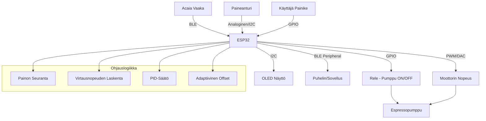

# Espresso Controller - Toteutussuunnitelma

## Projektin Tavoitteet

### Vaihe 1: Perus Painon Mukaan Ohjaus

1. Yhteys Acaia-vaakaan Bluetooth BLE:llä
2. Releen ohjaus kun tavoitepaino (esim. 36g) saavutetaan
3. Koodin siirto Arduino-kortille

### Vaihe 2: Paineohjattu Virtausnopeus

1. Paineanturin lukeminen (E61-ryhmä)
2. Virtausnopeuden laskenta ja seuranta
3. Pumpun moottorin säätö (analoginen ohjaus)
4. Adaptiivinen paineohjaus tavoitteen saavuttamiseksi:
   - **Tavoite:** 18g kahvia → 36g juomaa, 20-25 sekunnissa
   - **Ideaalivirtaus:** 36g / 20s = 1.8 g/s
   - **Paine:** 9 bar (normaali), säädettävä tarpeen mukaan
   - **Max aika:** 30 sekuntia

## Laitteistovaatimukset

### Suositeltu Arduino-Kortti: ESP32-DevKit tai ESP32-S3

**Perustelut:**

- ✅ Bluetooth BLE sisäänrakennettu
- ✅ WiFi (tulevaisuutta varten)
- ✅ Riittävästi GPIO-pinneja (30+)
- ✅ ADC-tulot paineanturille (12-bit, 0-3.3V)
- ✅ PWM-lähdöt moottorin ohjaukseen
- ✅ Riittävästi muistia (520KB RAM, 4MB Flash)
- ✅ Nopea prosessori (240 MHz dual-core)
- ✅ Hinta ~5-10€

**Vaihtoehto:** Arduino Nano ESP32 (pienempi, mutta samat ominaisuudet)

### Näyttö

**Suositus:** 0.96" tai 1.3" OLED I2C-näyttö (SSD1306 tai SH1106)

**Näytettävät tiedot:**

```
┌─────────────────────┐
│ Weight: 24.5g/36g   │
│ Flow: 1.8 g/s       │
│ Pressure: 9.0 bar   │
│ Time: 15s           │
│ Status: BREWING     │
└─────────────────────┘
```

**Kirjasto:** Adafruit_SSD1306 tai U8g2

### Paineanturi E61-Ryhmään

**Suositellut Vaihtoehdot:**

#### Vaihtoehto 1: Analoginen 0-10V Paineanturi (Suositus)

- **Tyyppi:** 0-16 bar tai 0-20 bar
- **Lähtö:** 0-10V analoginen
- **Liitäntä:** 1/8" NPT tai M10x1 (E61-yhteensopiva)
- **Esimerkki:** Wika A-10, Danfoss MBS 3000
- **Hinta:** ~50-100€

**Kytkentä ESP32:een:**

```
Paineanturi (0-10V) → Jännitteenjakaja (10V → 3.3V) → ESP32 ADC
```

**Jännitteenjakaja:**

```
10V ──┬── 6.8kΩ ──┬── ESP32 ADC (GPIO34)
      │           │
      └── 3.3kΩ ──┴── GND

Vout = 10V * (3.3kΩ / (6.8kΩ + 3.3kΩ)) = 3.27V
```

#### Vaihtoehto 2: I2C Digitaalinen Paineanturi

- **Tyyppi:** Honeywell HSCDRRN001PDAA5 tai vastaava
- **Lähtö:** I2C digitaalinen
- **Mittausalue:** 0-1 MPa (0-10 bar) tai 0-1.6 MPa (0-16 bar)
- **Hinta:** ~30-60€
- **Etu:** Ei tarvitse ADC:tä, tarkempi

### Pumpun Moottorin Ohjaus

**Suositellut Vaihtoehdot:**

#### Vaihtoehto 1: PWM + MOSFET (DC-Moottori)

Jos pumpussa on DC-moottori (harvinainen espressokoneissa):

```
ESP32 PWM → MOSFET (IRLZ44N) → DC-Moottori
```

#### Vaihtoehto 2: 0-10V Analoginen Ohjaus (Suositus)

Useimmat espressokoneiden pumput käyttävät AC-moottoria + taajuusmuuttajaa:

```
ESP32 PWM → RC-suodatin → Vahvistin (0-10V) → Taajuusmuuttaja → AC-Moottori
```

**PWM → 0-10V Muunnin:**

- **Vaihtoehto A:** DAC-piiri (MCP4725, 12-bit I2C DAC)
- **Vaihtoehto B:** PWM + RC-suodatin + Op-Amp vahvistin

**Esimerkki DAC-kytkennällä:**

```cpp
#include <Adafruit_MCP4725.h>

Adafruit_MCP4725 dac;

void setPumpSpeed(float percent) {
    // 0-100% → 0-4095 (12-bit)
    uint16_t value = (uint16_t)(percent * 40.95);
    dac.setVoltage(value, false);
}
```

#### Vaihtoehto 3: Rele + Triac Dimmer (Yksinkertaisin)

Jos halutaan vain yksinkertainen ohjaus:

```
ESP32 PWM → Triac-dimmer (BTA16) → AC-Moottori
```

**Huom:** Tämä ei ole yhtä tarkka kuin taajuusmuuttaja.

### Rele Pumpun Päälle/Pois

**Tyyppi:** 5V tai 3.3V rele-moduuli (optoeristetty)

- **Kuorma:** 10A @ 250VAC (riittävä espressopumpulle)
- **Ohjaus:** GPIO-pinni
- **Esimerkki:** SRD-05VDC-SL-C

## Järjestelmän Arkkitehtuuri



## Ohjelmiston Arkkitehtuuri

### Moduulirakenne

```
espresso-controller/
├── src/
│   ├── main.cpp                    # Pääohjelma
│   ├── config.h                    # Konfiguraatio
│   ├── scale/
│   │   ├── AcaiaScale.h           # Vaaka-luokka (olemassa oleva)
│   │   └── AcaiaScale.cpp
│   ├── pressure/
│   │   ├── PressureSensor.h       # Paineanturi-luokka
│   │   └── PressureSensor.cpp
│   ├── pump/
│   │   ├── PumpController.h       # Pumpun ohjaus
│   │   └── PumpController.cpp
│   ├── control/
│   │   ├── FlowController.h       # Virtausnopeuden ohjaus
│   │   ├── FlowController.cpp
│   │   ├── PIDController.h        # PID-säätö
│   │   └── PIDController.cpp
│   ├── display/
│   │   ├── Display.h              # OLED-näyttö
│   │   └── Display.cpp
│   └── utils/
│       ├── MovingAverage.h        # Liukuva keskiarvo
│       └── DataLogger.h           # Datan tallennus
├── include/
│   └── pins.h                     # GPIO-määrittelyt
└── platformio.ini                 # PlatformIO config
```

## Vaihe 1: Perus Painon Mukaan Ohjaus

### Toiminnallisuus

1. **Yhdistä vaakaan** (olemassa oleva koodi)
2. **Lue painoa** jatkuvasti
3. **Käynnistä shotti** kun käyttäjä painaa nappia
4. **Pysäytä shotti** kun `currentWeight >= (goalWeight - offset)`
5. **Päivitä offset** shotin jälkeen

### Koodirakenne (Vaihe 1)

```cpp
// main.cpp - Vaihe 1

#include <AcaiaArduinoBLE.h>
#include <EEPROM.h>
#include "Display.h"
#include "config.h"

// GPIO-määrittelyt
#define BREW_BUTTON_PIN  21
#define RELAY_PIN        22
#define LED_PIN          2

// Globaalit muuttujat
AcaiaArduinoBLE scale(false);
Display display;

float currentWeight = 0;
float goalWeight = 36.0;
float weightOffset = 1.5;

enum BrewState {
    IDLE,
    BREWING,
    ANALYZING
};

BrewState state = IDLE;
unsigned long brewStartTime = 0;
unsigned long brewEndTime = 0;

void setup() {
    Serial.begin(115200);

    // GPIO
    pinMode(BREW_BUTTON_PIN, INPUT_PULLUP);
    pinMode(RELAY_PIN, OUTPUT);
    pinMode(LED_PIN, OUTPUT);
    digitalWrite(RELAY_PIN, LOW);

    // EEPROM
    EEPROM.begin(512);
    loadSettings();

    // Näyttö
    display.init();
    display.showStatus("Connecting...");

    // Yhdistä vaakaan
    while(!scale.isConnected()) {
        scale.init();
        delay(1000);
    }

    display.showStatus("Ready");
}

void loop() {
    // Heartbeat
    if(scale.heartbeatRequired()) {
        scale.heartbeat();
    }

    // Lue paino
    if(scale.newWeightAvailable()) {
        currentWeight = scale.getWeight();
        display.updateWeight(currentWeight, goalWeight);
    }

    // Tila-automaatti
    switch(state) {
        case IDLE:
            handleIdleState();
            break;
        case BREWING:
            handleBrewingState();
            break;
        case ANALYZING:
            handleAnalyzingState();
            break;
    }

    delay(10);
}

void handleIdleState() {
    // Tarkista painike
    if(digitalRead(BREW_BUTTON_PIN) == LOW) {
        startBrew();
    }
}

void handleBrewingState() {
    unsigned long brewTime = millis() - brewStartTime;
    display.updateBrewTime(brewTime / 1000.0);

    // Tarkista pysäytysehto
    if(currentWeight >= (goalWeight - weightOffset)) {
        stopBrew();
    }

    // Timeout
    if(brewTime > 50000) {
        stopBrew();
    }
}

void handleAnalyzingState() {
    // Odota 3 sekuntia jälkitippumista
    if(millis() - brewEndTime > 3000) {
        updateOffset();
        state = IDLE;
        display.showStatus("Ready");
    }
}

void startBrew() {
    Serial.println("Starting brew...");
    state = BREWING;
    brewStartTime = millis();

    // Käynnistä pumppu
    digitalWrite(RELAY_PIN, HIGH);
    digitalWrite(LED_PIN, HIGH);

    // Nollaa vaaka
    scale.tare();
    scale.startTimer();

    display.showStatus("Brewing");
}

void stopBrew() {
    Serial.println("Stopping brew...");
    brewEndTime = millis();

    // Pysäytä pumppu
    digitalWrite(RELAY_PIN, LOW);
    digitalWrite(LED_PIN, LOW);

    scale.stopTimer();

    state = ANALYZING;
    display.showStatus("Analyzing");
}

void updateOffset() {
    float error = currentWeight - goalWeight;

    Serial.print("Final weight: ");
    Serial.print(currentWeight);
    Serial.print("g, Error: ");
    Serial.print(error);
    Serial.println("g");

    // Päivitä offset jos virhe ei ole liian suuri
    if(abs(error) < 5.0) {
        weightOffset += error;

        // Rajoita offset
        weightOffset = constrain(weightOffset, 0, 10.0);

        // Tallenna
        saveSettings();

        Serial.print("New offset: ");
        Serial.println(weightOffset);
    }
}

void loadSettings() {
    goalWeight = EEPROM.readFloat(0);
    weightOffset = EEPROM.readFloat(4);

    // Oletusarvot
    if(isnan(goalWeight) || goalWeight < 10 || goalWeight > 100) {
        goalWeight = 36.0;
    }
    if(isnan(weightOffset) || weightOffset < 0 || weightOffset > 10) {
        weightOffset = 1.5;
    }
}

void saveSettings() {
    EEPROM.writeFloat(0, goalWeight);
    EEPROM.writeFloat(4, weightOffset);
    EEPROM.commit();
}
```

### Display-Luokka (Vaihe 1)

```cpp
// Display.h

#ifndef DISPLAY_H
#define DISPLAY_H

#include <Wire.h>
#include <Adafruit_GFX.h>
#include <Adafruit_SSD1306.h>

#define SCREEN_WIDTH 128
#define SCREEN_HEIGHT 64
#define OLED_RESET -1

class Display {
public:
    Display();
    void init();
    void showStatus(const char* status);
    void updateWeight(float current, float goal);
    void updateBrewTime(float seconds);
    void clear();

private:
    Adafruit_SSD1306 display;
};

#endif
```

```cpp
// Display.cpp

#include "Display.h"

Display::Display() : display(SCREEN_WIDTH, SCREEN_HEIGHT, &Wire, OLED_RESET) {}

void Display::init() {
    if(!display.begin(SSD1306_SWITCHCAPVCC, 0x3C)) {
        Serial.println("SSD1306 allocation failed");
        for(;;);
    }
    display.clearDisplay();
    display.setTextSize(1);
    display.setTextColor(SSD1306_WHITE);
    display.display();
}

void Display::showStatus(const char* status) {
    display.clearDisplay();
    display.setCursor(0, 0);
    display.setTextSize(2);
    display.println(status);
    display.display();
}

void Display::updateWeight(float current, float goal) {
    display.clearDisplay();

    // Paino
    display.setCursor(0, 0);
    display.setTextSize(1);
    display.print("Weight:");

    display.setCursor(0, 15);
    display.setTextSize(2);
    display.print(current, 1);
    display.print("/");
    display.print(goal, 0);
    display.println("g");

    display.display();
}

void Display::updateBrewTime(float seconds) {
    display.setCursor(0, 40);
    display.setTextSize(1);
    display.print("Time: ");
    display.print(seconds, 1);
    display.println("s");
    display.display();
}

void Display::clear() {
    display.clearDisplay();
    display.display();
}
```

## Vaihe 2: Paineohjattu Virtausnopeus

### Toiminnallisuus

1. **Lue paineanturi** jatkuvasti
2. **Laske virtausnopeus** (g/s) painon muutoksesta
3. **Säädä pumpun nopeutta** PID-säätimellä
4. **Tavoite:** 36g / 20s = 1.8 g/s
5. **Adaptiivinen säätö:** Jos virtaus liian nopea → laske painetta

### Virtausnopeuden Laskenta

```cpp
// Liukuva keskiarvo viimeisestä N mittauksesta
#define FLOW_WINDOW_SIZE 10

float weightHistory[FLOW_WINDOW_SIZE];
unsigned long timeHistory[FLOW_WINDOW_SIZE];
int historyIndex = 0;

float calculateFlowRate() {
    // Lisää uusi mittaus
    weightHistory[historyIndex] = currentWeight;
    timeHistory[historyIndex] = millis();
    historyIndex = (historyIndex + 1) % FLOW_WINDOW_SIZE;

    // Laske lineaarinen regressio
    float sumX = 0, sumY = 0, sumXY = 0, sumX2 = 0;
    int n = FLOW_WINDOW_SIZE;

    for(int i = 0; i < n; i++) {
        float x = timeHistory[i] / 1000.0; // sekunteina
        float y = weightHistory[i];
        sumX += x;
        sumY += y;
        sumXY += x * y;
        sumX2 += x * x;
    }

    // Kulmakerroin = virtausnopeus (g/s)
    float slope = (n * sumXY - sumX * sumY) / (n * sumX2 - sumX * sumX);

    return slope;
}
```

### PID-Säädin

```cpp
// PIDController.h

#ifndef PID_CONTROLLER_H
#define PID_CONTROLLER_H

class PIDController {
public:
    PIDController(float kp, float ki, float kd);

    void setTarget(float target);
    float compute(float input, float dt);
    void reset();

private:
    float kp, ki, kd;
    float target;
    float integral;
    float previousError;
};

#endif
```

```cpp
// PIDController.cpp

#include "PIDController.h"

PIDController::PIDController(float kp, float ki, float kd)
    : kp(kp), ki(ki), kd(kd), target(0), integral(0), previousError(0) {}

void PIDController::setTarget(float target) {
    this->target = target;
}

float PIDController::compute(float input, float dt) {
    float error = target - input;

    // Proportional
    float P = kp * error;

    // Integral
    integral += error * dt;
    float I = ki * integral;

    // Derivative
    float derivative = (error - previousError) / dt;
    float D = kd * derivative;

    previousError = error;

    return P + I + D;
}

void PIDController::reset() {
    integral = 0;
    previousError = 0;
}
```

### Paineanturi-Luokka

```cpp
// PressureSensor.h

#ifndef PRESSURE_SENSOR_H
#define PRESSURE_SENSOR_H

#include <Arduino.h>

class PressureSensor {
public:
    PressureSensor(int pin, float maxPressure = 16.0);

    void init();
    float readPressure();  // bar
    void calibrate();

private:
    int pin;
    float maxPressure;
    float offset;
    float scale;

    float readVoltage();
};

#endif
```

```cpp
// PressureSensor.cpp

#include "PressureSensor.h"

PressureSensor::PressureSensor(int pin, float maxPressure)
    : pin(pin), maxPressure(maxPressure), offset(0), scale(1.0) {}

void PressureSensor::init() {
    pinMode(pin, INPUT);
    calibrate();
}

float PressureSensor::readVoltage() {
    // ESP32 ADC: 12-bit (0-4095) → 0-3.3V
    int raw = analogRead(pin);
    return (raw / 4095.0) * 3.3;
}

float PressureSensor::readPressure() {
    float voltage = readVoltage();

    // 0-10V → 0-maxPressure bar
    // Meidän jännitteenjakaja: 10V → 3.3V
    float actualVoltage = voltage * (10.0 / 3.3);

    float pressure = (actualVoltage / 10.0) * maxPressure;

    return pressure - offset;
}

void PressureSensor::calibrate() {
    // Lue 100 näytettä ilman painetta
    float sum = 0;
    for(int i = 0; i < 100; i++) {
        sum += readPressure();
        delay(10);
    }
    offset = sum / 100.0;
}
```

### Pumpun Ohjaus

```cpp
// PumpController.h

#ifndef PUMP_CONTROLLER_H
#define PUMP_CONTROLLER_H

#include <Arduino.h>

class PumpController {
public:
    PumpController(int relayPin, int speedPin);

    void init();
    void turnOn();
    void turnOff();
    void setSpeed(float percent);  // 0-100%
    bool isRunning();

private:
    int relayPin;
    int speedPin;
    bool running;

    void setPWM(float percent);
};

#endif
```

```cpp
// PumpController.cpp

#include "PumpController.h"

PumpController::PumpController(int relayPin, int speedPin)
    : relayPin(relayPin), speedPin(speedPin), running(false) {}

void PumpController::init() {
    pinMode(relayPin, OUTPUT);
    pinMode(speedPin, OUTPUT);

    digitalWrite(relayPin, LOW);

    // PWM setup (ESP32)
    ledcSetup(0, 5000, 8);  // Channel 0, 5kHz, 8-bit
    ledcAttachPin(speedPin, 0);
}

void PumpController::turnOn() {
    digitalWrite(relayPin, HIGH);
    running = true;
}

void PumpController::turnOff() {
    digitalWrite(relayPin, LOW);
    setSpeed(0);
    running = false;
}

void PumpController::setSpeed(float percent) {
    percent = constrain(percent, 0, 100);
    setPWM(percent);
}

void PumpController::setPWM(float percent) {
    int value = (int)(percent * 2.55);  // 0-100 → 0-255
    ledcWrite(0, value);
}

bool PumpController::isRunning() {
    return running;
}
```

### Virtausnopeuden Ohjaus

```cpp
// FlowController.h

#ifndef FLOW_CONTROLLER_H
#define FLOW_CONTROLLER_H

#include "PIDController.h"
#include "PumpController.h"
#include "PressureSensor.h"

class FlowController {
public:
    FlowController(PumpController* pump, PressureSensor* sensor);

    void init();
    void setTargetFlow(float gPerSecond);
    void setTargetWeight(float grams);
    void setTargetTime(float seconds);
    void update(float currentWeight, float currentFlow, float elapsedTime);
    void reset();

    float getTargetFlow();
    float getPumpSpeed();

private:
    PumpController* pump;
    PressureSensor* sensor;
    PIDController flowPID;

    float targetFlow;
    float targetWeight;
    float targetTime;
    float currentPumpSpeed;

    void adjustPumpSpeed(float adjustment);
    float calculateAdaptiveFlow(float elapsedTime);
};

#endif
```

```cpp
// FlowController.cpp

#include "FlowController.h"

FlowController::FlowController(PumpController* pump, PressureSensor* sensor)
    : pump(pump), sensor(sensor), flowPID(2.0, 0.5, 0.1),
      targetFlow(1.8), targetWeight(36.0), targetTime(20.0), currentPumpSpeed(100.0) {}

void FlowController::init() {
    flowPID.setTarget(targetFlow);
}

void FlowController::setTargetFlow(float gPerSecond) {
    targetFlow = gPerSecond;
    flowPID.setTarget(targetFlow);
}

void FlowController::setTargetWeight(float grams) {
    targetWeight = grams;
}

void FlowController::setTargetTime(float seconds) {
    targetTime = seconds;
}

void FlowController::update(float currentWeight, float currentFlow, float elapsedTime) {
    // Laske adaptiivinen tavoitevirtaus
    float adaptiveFlow = calculateAdaptiveFlow(elapsedTime);
    flowPID.setTarget(adaptiveFlow);

    // PID-säätö
    float adjustment = flowPID.compute(currentFlow, 0.1);  // 100ms päivitysväli

    // Säädä pumpun nopeutta
    adjustPumpSpeed(adjustment);

    // Aseta pumpun nopeus
    pump->setSpeed(currentPumpSpeed);

    // Lue paine
    float pressure = sensor->readPressure();

    // Tulosta debug-tietoja
    Serial.print("Flow: ");
    Serial.print(currentFlow, 2);
    Serial.print(" g/s, Target: ");
    Serial.print(adaptiveFlow, 2);
    Serial.print(" g/s, Pump: ");
    Serial.print(currentPumpSpeed, 1);
    Serial.print("%, Pressure: ");
    Serial.print(pressure, 1);
    Serial.println(" bar");
}

float FlowController::calculateAdaptiveFlow(float elapsedTime) {
    // Laske jäljellä oleva aika ja paino
    float remainingTime = targetTime - elapsedTime;
    float remainingWeight = targetWeight - currentWeight;

    // Jos aikaa jäljellä, laske tarvittava virtaus
    if(remainingTime > 0 && remainingWeight > 0) {
        float requiredFlow = remainingWeight / remainingTime;

        // Rajoita virtaus järkeviin arvoihin
        requiredFlow = constrain(requiredFlow, 0.5, 3.0);

        return requiredFlow;
    }

    // Jos aika ylitetty, käytä hitaampaa virtausta
    if(elapsedTime > targetTime && elapsedTime < 30.0) {
        return 1.0;  // Hidas virtaus
    }

    // Oletusarvo
    return targetFlow;
}

void FlowController::adjustPumpSpeed(float adjustment) {
    currentPumpSpeed += adjustment;
    currentPumpSpeed = constrain(currentPumpSpeed, 30.0, 100.0);
}

void FlowController::reset() {
    flowPID.reset();
    currentPumpSpeed = 100.0;
}

float FlowController::getTargetFlow() {
    return targetFlow;
}

float FlowController::getPumpSpeed() {
    return currentPumpSpeed;
}
```

### Pääohjelma (Vaihe 2)

```cpp
// main.cpp - Vaihe 2

#include <AcaiaArduinoBLE.h>
#include "Display.h"
#include "PressureSensor.h"
#include "PumpController.h"
#include "FlowController.h"
#include "config.h"

// GPIO
#define BREW_BUTTON_PIN  21
#define RELAY_PIN        22
#define PUMP_SPEED_PIN   23
#define PRESSURE_PIN     34

// Objektit
AcaiaArduinoBLE scale(false);
Display display;
PressureSensor pressureSensor(PRESSURE_PIN, 16.0);
PumpController pump(RELAY_PIN, PUMP_SPEED_PIN);
FlowController flowController(&pump, &pressureSensor);

// Muuttujat
float currentWeight = 0;
float currentFlow = 0;
float currentPressure = 0;
float goalWeight = 36.0;
float targetTime = 20.0;

enum BrewState {
    IDLE,
    BREWING,
    ANALYZING
};

BrewState state = IDLE;
unsigned long brewStartTime = 0;
unsigned long lastFlowUpdate = 0;

// Virtausnopeuden laskenta
#define FLOW_WINDOW_SIZE 10
float weightHistory[FLOW_WINDOW_SIZE];
unsigned long timeHistory[FLOW_WINDOW_SIZE];
int historyIndex = 0;
int historyCount = 0;

void setup() {
    Serial.begin(115200);

    // GPIO
    pinMode(BREW_BUTTON_PIN, INPUT_PULLUP);

    // Alusta komponentit
    display.init();
    pressureSensor.init();
    pump.init();
    flowController.init();

    // Aseta tavoitteet
    flowController.setTargetWeight(goalWeight);
    flowController.setTargetTime(targetTime);
    flowController.setTargetFlow(goalWeight / targetTime);

    // Yhdistä vaakaan
    display.showStatus("Connecting...");
    while(!scale.isConnected()) {
        scale.init();
        delay(1000);
    }

    display.showStatus("Ready");
}

void loop() {
    // Heartbeat
    if(scale.heartbeatRequired()) {
        scale.heartbeat();
    }

    // Lue paino
    if(scale.newWeightAvailable()) {
        currentWeight = scale.getWeight();
        updateFlowHistory();
    }

    // Lue paine
    currentPressure = pressureSensor.readPressure();

    // Tila-automaatti
    switch(state) {
        case IDLE:
            handleIdleState();
            break;
        case BREWING:
            handleBrewingState();
            break;
        case ANALYZING:
            handleAnalyzingState();
            break;
    }

    // Päivitä näyttö
    updateDisplay();

    delay(10);
}

void handleIdleState() {
    if(digitalRead(BREW_BUTTON_PIN) == LOW) {
        startBrew();
    }
}

void handleBrewingState() {
    float elapsedTime = (millis() - brewStartTime) / 1000.0;

    // Päivitä virtausnopeuden ohjaus 100ms välein
    if(millis() - lastFlowUpdate > 100) {
        currentFlow = calculateFlowRate();
        flowController.update(currentWeight, currentFlow, elapsedTime);
        lastFlowUpdate = millis();
    }

    // Tarkista pysäytysehto
    if(currentWeight >= goalWeight) {
        stopBrew();
    }

    // Max aika
    if(elapsedTime > 30.0) {
        stopBrew();
    }
}

void handleAnalyzingState() {
    // Odota 3 sekuntia
    if(millis() - brewEndTime > 3000) {
        state = IDLE;
        display.showStatus("Ready");
    }
}

void startBrew() {
    Serial.println("Starting brew...");
    state = BREWING;
    brewStartTime = millis();
    lastFlowUpdate = millis();

    // Nollaa historia
    historyIndex = 0;
    historyCount = 0;

    // Käynnistä pumppu
    pump.turnOn();
    pump.setSpeed(100);  // Aloita täydellä teholla

    // Nollaa vaaka
    scale.tare();
    scale.startTimer();

    // Nollaa PID
    flowController.reset();

    display.showStatus("Brewing");
}

void stopBrew() {
    Serial.println("Stopping brew...");
    brewEndTime = millis();

    // Pysäytä pumppu
    pump.turnOff();

    scale.stopTimer();

    state = ANALYZING;
    display.showStatus("Done");
}

void updateFlowHistory() {
    weightHistory[historyIndex] = currentWeight;
    timeHistory[historyIndex] = millis();
    historyIndex = (historyIndex + 1) % FLOW_WINDOW_SIZE;

    if(historyCount < FLOW_WINDOW_SIZE) {
        historyCount++;
    }
}

float calculateFlowRate() {
    if(historyCount < 2) {
        return 0;
    }

    // Käytä lineaarista regressiota
    float sumX = 0, sumY = 0, sumXY = 0, sumX2 = 0;
    int n = historyCount;

    for(int i = 0; i < n; i++) {
        float x = timeHistory[i] / 1000.0;
        float y = weightHistory[i];
        sumX += x;
        sumY += y;
        sumXY += x * y;
        sumX2 += x * x;
    }

    float slope = (n * sumXY - sumX * sumY) / (n * sumX2 - sumX * sumX);

    return max(0.0f, slope);
}

void updateDisplay() {
    display.clearDisplay();

    float elapsedTime = 0;
    if(state == BREWING) {
        elapsedTime = (millis() - brewStartTime) / 1000.0;
    }

    // Rivi 1: Paino
    display.setCursor(0, 0);
    display.setTextSize(1);
    display.print("Weight: ");
    display.print(currentWeight, 1);
    display.print("/");
    display.print(goalWeight, 0);
    display.println("g");

    // Rivi 2: Virtaus
    display.setCursor(0, 12);
    display.print("Flow: ");
    display.print(currentFlow, 2);
    display.println(" g/s");

    // Rivi 3: Paine
    display.setCursor(0, 24);
    display.print("Pressure: ");
    display.print(currentPressure, 1);
    display.println(" bar");

    // Rivi 4: Aika
    display.setCursor(0, 36);
    display.print("Time: ");
    display.print(elapsedTime, 1);
    display.println("s");

    // Rivi 5: Pumpun nopeus
    if(state == BREWING) {
        display.setCursor(0, 48);
        display.print("Pump: ");
        display.print(flowController.getPumpSpeed(), 0);
        display.println("%");
    }

    display.display();
}
```

## Ohjausalgoritmi - Yksityiskohtainen Kuvaus

### Tavoite

- **Kahvimäärä:** 18g
- **Juomamäärä:** 36g (2:1 ratio)
- **Aika:** 20-25 sekuntia (ideaali 20s)
- **Max aika:** 30 sekuntia
- **Paine:** 9 bar (normaali), säädettävä

### Algoritmi

```
1. Aloita täydellä pumpun teholla (100%)
2. Laske virtausnopeus jatkuvasti (g/s)
3. Laske tarvittava virtausnopeus:

   required_flow = (target_weight - current_weight) / (target_time - elapsed_time)

4. Säädä pumpun nopeutta PID-säätimellä:

   error = required_flow - current_flow
   pump_adjustment = PID(error)
   pump_speed += pump_adjustment

5. Rajoita pumpun nopeus: 30-100%

6. Jos aika ylittää 20s mutta paino ei ole saavutettu:
   - Jatka hitaammalla virtauksella (1.0 g/s)
   - Max aika 30s

7. Pysäytä kun:
   - Paino >= 36g TAI
   - Aika >= 30s
```

### PID-Parametrit

**Suositellut alkuarvot:**

```cpp
Kp = 2.0   // Proportional gain
Ki = 0.5   // Integral gain
Kd = 0.1   // Derivative gain
```

**Viritys:**

1. Aloita Kp = 2.0, Ki = 0, Kd = 0
2. Nosta Kp kunnes järjestelmä värähtelee
3. Laske Kp puoleen
4. Lisää Ki hitaasti (0.1 → 0.5)
5. Lisää Kd jos tarvitaan (yleensä pieni)

### Esimerkki Shotin Kulku

```
Aika | Paino | Virtaus | Tarvittu | Pumppu | Paine
-----|-------|---------|----------|--------|-------
 0s  |  0g   | 0.0 g/s |  1.8 g/s |  100%  | 9.0 bar
 5s  |  8g   | 1.6 g/s |  1.8 g/s |   95%  | 8.8 bar
10s  | 17g   | 1.8 g/s |  1.9 g/s |   98%  | 9.0 bar
15s  | 27g   | 2.0 g/s |  1.8 g/s |   90%  | 8.5 bar
20s  | 36g   | 1.8 g/s |  0.0 g/s |    0%  | 0.0 bar
```

## Laitteiston Kytkentäkaavio

```
ESP32 DevKit
┌─────────────────────────────────────┐
│                                     │
│  GPIO21 ──────────────┐             │
│                       │             │
│  GPIO22 ────────┐     │             │
│                 │     │             │
│  GPIO23 ──┐     │     │             │
│           │     │     │             │
│  GPIO34 ──┼─────┼─────┼────────┐    │
│           │     │     │        │    │
│  GPIO18 ──┼─────┼─────┼────┐   │    │
│  GPIO19 ──┼─────┼─────┼──┐ │   │    │
│           │     │     │  │ │   │    │
│  3.3V ────┼─────┼─────┼──┼─┼───┼──┐ │
│  GND ─────┼─────┼─────┼──┼─┼───┼──┼─┤
│           │     │     │  │ │   │  │ │
└───────────┼─────┼─────┼──┼─┼───┼──┼─┘
            │     │     │  │ │   │  │
            │     │     │  │ │   │  │
         ┌──┴──┐  │     │  │ │   │  │
         │Brew │  │     │  │ │   │  │
         │Btn  │  │     │  │ │   │  │
         └──┬──┘  │     │  │ │   │  │
            │     │     │  │ │   │  │
         ┌──┴─────┴──┐  │  │ │   │  │
         │  Rele     │  │  │ │   │  │
         │  Moduuli  │  │  │ │   │  │
         └──┬────────┘  │  │ │   │  │
            │           │  │ │   │  │
         ┌──┴───────────┴──┐ │   │  │
         │  Pumppu         │ │   │  │
         │  (AC 230V)      │ │   │  │
         └─────────────────┘ │   │  │
                             │   │  │
         ┌───────────────────┴─┐ │  │
         │  PWM → 0-10V        │ │  │
         │  Muunnin (DAC)      │ │  │
         └───────────┬─────────┘ │  │
                     │            │  │
         ┌───────────┴──────────┐ │  │
         │  Taajuusmuuttaja     │ │  │
         │  (VFD)               │ │  │
         └──────────────────────┘ │  │
                                  │  │
         ┌────────────────────────┴─┐│
         │  Paineanturi             ││
         │  (0-10V → 0-16 bar)      ││
         │                          ││
         │  ┌────────────────┐      ││
         │  │ Jännitteenjakaja│     ││
         │  │ 10V → 3.3V      │     ││
         │  └────────┬────────┘     ││
         └───────────┼──────────────┘│
                     │                │
         ┌───────────┴────────────────┴┐
         │  OLED Näyttö (I2C)          │
         │  SDA: GPIO18                │
         │  SCL: GPIO19                │
         └─────────────────────────────┘
```

## Testausstrategia

### Vaihe 1 Testit

1. **Bluetooth-Yhteys**
   - Yhdistä vaakaan
   - Tarkista painon lukeminen
   - Testaa yhteyden katkeaminen

2. **Releen Ohjaus**
   - Testaa releen kytkeminen/katkaiseminen
   - Mittaa viive

3. **Painon Mukaan Pysäytys**
   - Testaa eri tavoitepainoilla (20g, 36g, 50g)
   - Tarkista tarkkuus (±0.5g)

4. **Offset-Oppiminen**
   - Tee 10 shottia
   - Tarkista offset-konvergenssi

### Vaihe 2 Testit

1. **Paineanturin Lukeminen**
   - Kalibroi ilman painetta
   - Testaa eri paineilla (0, 5, 9, 12 bar)
   - Tarkista tarkkuus

2. **Virtausnopeuden Laskenta**
   - Simuloi eri virtausnopeuksia
   - Tarkista laskenta-algoritmi

3. **PID-Säätö**
   - Testaa eri PID-parametreilla
   - Optimoi parametrit

4. **Täysi Shotti-Sykli**
   - Tee 20 shottia
   - Mittaa:
     - Lopullinen paino (tavoite ±1g)
     - Aika (tavoite 20±2s)
     - Virtausnopeuden vaihtelu
     - Paineen vaihtelu

5. **Pitkäaikaistestaus**
   - 100+ shottia
   - Tarkista:
     - Muistivuodot
     - Yhteyden vakaus
     - Offset-konvergenssi

## Turvallisuus

### Sähköturvallisuus

1. **Eristys**
   - Käytä optoeristettyjä releeitä
   - Älä kosketa 230V-johtoja

2. **Suojaus**
   - Lisää sulake pumpun virtapiiriin
   - Käytä vikavirtasuojaa

3. **Kotelo**
   - Sulje kaikki 230V-osat koteloihin
   - Merkitse varoituskilvet

### Ohjelmistoturvallisuus

1. **Timeout**
   - Max shotti-aika 30s
   - Pysäytä pumppu aina timeoutissa

2. **Virheenkäsittely**
   - Jos vaaka katkeaa → pysäytä pumppu
   - Jos paineanturi antaa virheellisen arvon → pysäytä

3. **Watchdog**
   - Käytä ESP32:n watchdog-ajastinta
   - Reset jos ohjelma jumittuu

```cpp
#include <esp_task_wdt.h>

void setup() {
    // Watchdog 10 sekuntia
    esp_task_wdt_init(10, true);
    esp_task_wdt_add(NULL);
}

void loop() {
    // Reset watchdog
    esp_task_wdt_reset();

    // ... muu koodi ...
}
```

## Kustannusarvio

| Komponentti                        | Hinta (€) |
| ---------------------------------- | --------- |
| ESP32 DevKit                       | 8         |
| OLED-näyttö (0.96" I2C)            | 5         |
| Paineanturi (0-16 bar, analoginen) | 60        |
| Rele-moduuli (5V, 10A)             | 3         |
| DAC-piiri (MCP4725)                | 5         |
| Jännitteenjakajan vastukset        | 1         |
| Kytkentäjohdot, liittimet          | 10        |
| PCB (valinnainen)                  | 10        |
| Kotelo                             | 15        |
| **Yhteensä**                       | **~117€** |

**Huom:** Ei sisällä taajuusmuuttajaa (jos tarvitaan), hinta +100-200€

## Aikataulu

### Vaihe 1 (1-2 viikkoa)

- [ ] Hanki komponentit (ESP32, OLED, rele)
- [ ] Rakenna prototyyppi breadboardilla
- [ ] Siirrä olemassa oleva koodi ESP32:lle
- [ ] Lisää OLED-näyttö
- [ ] Testaa vaaka-yhteys ja releen ohjaus
- [ ] Testaa painon mukaan pysäytys
- [ ] Rakenna lopullinen kytkentä

### Vaihe 2 (2-4 viikkoa)

- [ ] Hanki paineanturi ja asennustarvikkeet
- [ ] Asenna paineanturi E61-ryhmään
- [ ] Testaa paineanturin lukeminen
- [ ] Toteuta virtausnopeuden laskenta
- [ ] Toteuta PID-säädin
- [ ] Hanki/rakenna pumpun ohjaus (DAC tai VFD)
- [ ] Testaa pumpun ohjaus
- [ ] Integroi kaikki komponentit
- [ ] Viritä PID-parametrit
- [ ] Testaa täysi järjestelmä
- [ ] Optimoi algoritmi

## Yhteenveto

Projekti on toteutettavissa kahdessa vaiheessa:

**Vaihe 1** on yksinkertainen ja nopea toteuttaa. Se tarjoaa jo merkittävän parannuksen manuaaliseen pysäytykseen.

**Vaihe 2** on monimutkaisempi ja vaatii enemmän laitteistoa ja viritystä, mutta tarjoaa täyden automaattisen virtausnopeuden ohjauksen.

Suosittelen aloittamaan Vaiheesta 1 ja siirtymään Vaiheeseen 2 kun se toimii luotettavasti.

Molemmat vaiheet on suunniteltu modulaarisiksi, joten koodi on helppo laajentaa ja ylläpitää.
